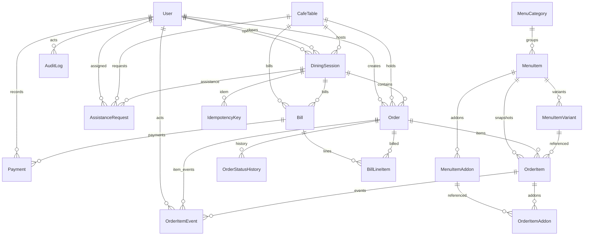

# Database Design

## Money representation
All monetary columns are integers in **minor units (paise)**. Currency is configurable
(default `INR`). Tax/service charge are stored in **basis points** (500 = 5%).

## Entity-relationship diagram

## Tables (summary)
| Model | Purpose | Key constraints / indexes |
|-------|---------|---------------------------|
| User | staff accounts | unique email, role enum, isActive |
| CafeTable | physical tables | unique number, unique unpredictable `qrToken`, status enum |
| DiningSession | one visit | FK table/user, status enum, `(tableId,status)` index |
| MenuCategory / MenuItem / Variant / Addon | catalog | FKs, `(categoryId,isAvailable)` index, money in minor |
| Order | an order | unique orderNumber, FK session/table, **derived** status enum, `(sessionId,status)` |
| OrderItem | snapshot lines | name/unit/line price snapshotted; per-line `status` (`OrderItemStatus`), `preparingAt`/`readyAt`/`servedAt`/`cancelledAt`/`cancelReason`, `(orderId)` + `(status,updatedAt)` indexes |
| OrderItemAddon | addon snapshot | name/price snapshotted |
| OrderStatusHistory | audit of the derived order summary | `(orderId,createdAt)` |
| OrderItemEvent | immutable per-item status history | `fromStatus`/`toStatus` (`OrderItemStatus`), actor, source (`STAFF`/`CUSTOMER`/`SYSTEM`), reason; `(orderItemId,createdAt)` + `(orderId)` indexes |
| Bill | immutable billing snapshot | unique billNumber, FK session/table, totals snapshotted |
| BillLineItem | snapshot lines | name/unit/line snapshotted from order items |
| Payment | payment records | FK bill/user, amount minor, method, no card data |
| AssistanceRequest | "call waiter" | FK session/table, status |
| AuditLog | privileged actions | actor/action/entity, `(createdAt)` |
| IdempotencyKey | dedup orders | unique key, FK session, resourceId, expiry |
| Settings | singleton café config | tax/service bps, currency, rounding |

## Data-integrity rules
- An order must reference an existing **active** session (enforced in the order-creation
  transaction; session row locked `FOR UPDATE`). A closed/stale session is rejected even when the
  client still holds a page for it.
- Preparation is tracked **per line item** (`OrderItem.status`); the order's `Order.status` is a
  derived summary recomputed from its items on every transition and is never written directly.
- Every item transition is recorded as an append-only `OrderItemEvent`; legal transitions and
  roles are enforced in `apps/api/src/lib/orderState.ts`.
- A table cannot have more than one non-closed session (checked under lock + unique logic).
- Closing a session is blocked while an unpaid bill or unresolved (not completed/cancelled) order
  exists; the check uses the derived summary statuses.
- Cancelled line items are excluded from bills.
- Monetary math only via integer minor units (see `apps/api/src/lib/money.ts`).
- Prices/names on orders and bills are **snapshots**; later menu edits do not rewrite history.
- QR `qrToken` is a 64-char unpredictable hex string; it identifies a table, not an authorization.
- Order/bill numbers come from Postgres sequences (`cafe_order_number_seq`, `cafe_bill_number_seq`)
  so concurrent insertions cannot collide.

## Indexing rationale
- `DiningSession(tableId, status)` — fast "is this table active" lookups on every order.
- `Order(sessionId, status)` / `Order(status, createdAt)` — kitchen and dashboard queries.
- `OrderItem(orderId)` / `(status, updatedAt)` — "items for this order" and the ready-dish queue.
- `OrderItemEvent(orderItemId, createdAt)` / `(orderId)` — per-item audit trail.
- `Bill(sessionId, status)` — payment/closure checks.
- `AuditLog(createdAt)` / `(entityType,entityId)` — admin audit views.
- `IdempotencyKey(key)` unique — hard guarantee against duplicate orders.

## Backups & restore (PostgreSQL)
- Logical dump: `pg_dump -Fc cafe_db -f backup.dump`
- Restore: `pg_restore --clean --if-exists -d cafe_db backup.dump`
- For production: enable continuous archiving / managed backups; test restore regularly.
  See docs/DEPLOYMENT.md.
